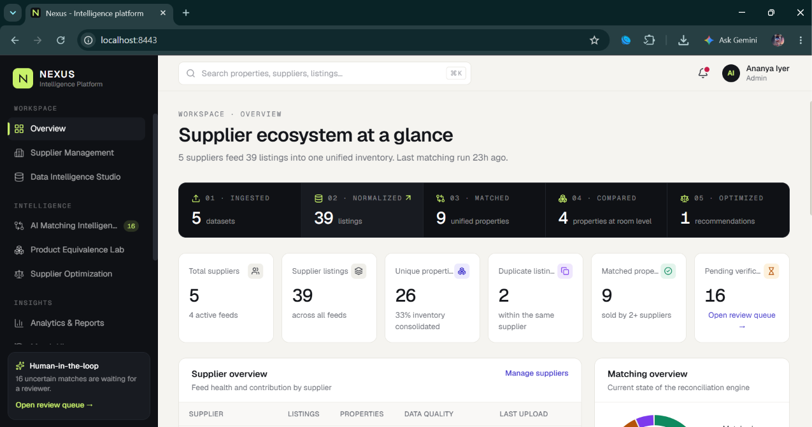
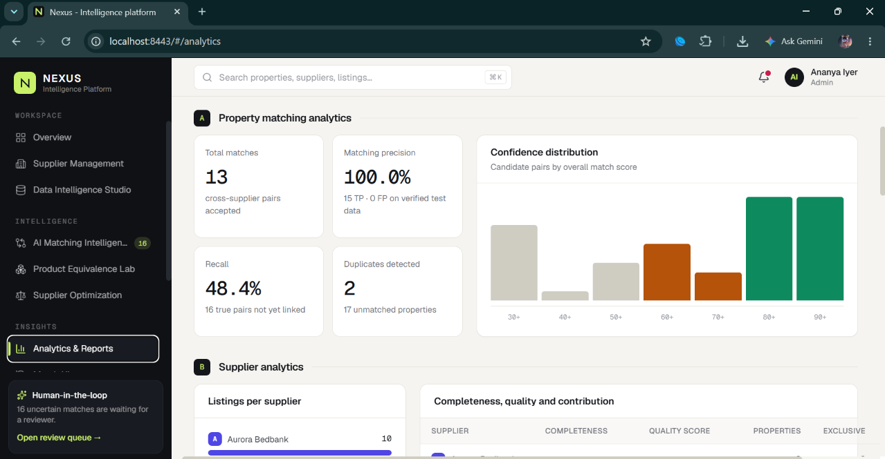
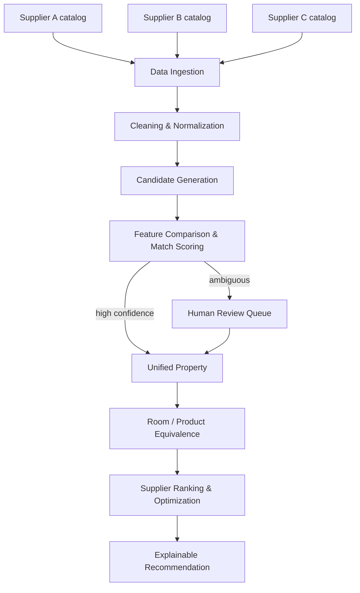

<div align="center">

# NEXUS

### Multi-Supplier Intelligence & Optimization Platform

**Turn fragmented supplier catalogs into one unified, comparable, and optimized inventory.**


</div>

---

## 🎯 The Problem

Travel platforms receive hotel and room inventory from many suppliers. The same property shows up under different names, addresses, and data formats, and the offers attached to it are rarely described the same way.

| Pain point | Consequence |
|---|---|
| Duplicate listings across suppliers | Inflated inventory, confusing search results |
| Inconsistent or incomplete data | Unreliable matching and reporting |
| Room products described differently | Hard to tell what is truly the same product |
| Inclusions and policies differ | **Misleading price comparisons** (e.g. refundable + breakfast vs. non-refundable room-only) |
| Manual verification | Slow, expensive, and error-prone |
| Many competing business priorities | No principled way to choose the best supplier |

## 💡 Our Solution

NEXUS answers two questions that basic name-matching cannot:

1. **Are these listings the same real-world property?**
2. **Are the products on offer genuinely equivalent?**

Only then does it rank suppliers, so the result is *the best offer among comparable products*, not just the cheapest one.

```
Ingest → Normalize → Match → Compare → Optimize → Explain → Human Review
```

---

## 📸 Screenshots

### Overview dashboard
The pipeline at a glance (ingested → normalized → matched → compared → optimized), with live counts and a shortcut into the human review queue.



### Supplier management
Every connected supplier with its type, listing and property counts, data-quality score, and integration health (Live API, Batch SFTP, Manual Upload, Paused).


### Matching analytics
Match precision and recall, duplicate detection, and the confidence distribution of candidate pairs.



> Screenshots show the prototype running on the sample dataset (5 suppliers, 39 listings).

---

## ✨ Key Features

<details open>
<summary><b>1. Multi-supplier ingestion</b></summary>

- Upload CSV / Excel catalogs per supplier
- Preview records and map supplier-specific columns to a standard schema
- Track upload and processing status
</details>

<details open>
<summary><b>2. Cleaning & normalization</b></summary>

- Standardize property names, addresses, room descriptions, and amenities
- Convert prices to consistent numeric formats and currencies
- Detect missing, invalid, and duplicate records
- Generate a data-quality summary per supplier
</details>

<details open>
<summary><b>3. AI-assisted property matching</b></summary>

Combines multiple signals into a single match-confidence score:

| Signal | Technique |
|---|---|
| Name similarity | Fuzzy matching (RapidFuzz) |
| Semantic similarity | Sentence-transformer embeddings |
| Location | Geographic distance (when coordinates exist) |
| Address / attributes | Structured field comparison |

Every match comes with **inspectable evidence**; users can confirm, reject, or flag it.
</details>

<details open>
<summary><b>4. Room & product equivalence</b></summary>

Compares room category, bed configuration, occupancy, size, view, amenities, meal plan, cancellation/refund terms, and taxes/fees.

| Class | Meaning |
|---|---|
| 🟢 **Exact Equivalent** | Essential attributes and conditions align |
| 🟡 **Similar Product** | Broadly the same, with limited differences |
| 🟠 **Partially Equivalent** | Important differences must be weighed |
| 🔴 **Non-Equivalent** | Not suitable for direct comparison |
| ⚪ **Needs Review** | Data is incomplete or conflicting |
</details>

<details open>
<summary><b>5. Supplier optimization</b></summary>

Rank offers using configurable weights and hard constraints:

- Price · product equivalence · cancellation flexibility
- Match confidence · supplier reliability · availability *(when present in the data)*

Output: ranked options, trade-offs, constraint checks, and a plain-language explanation.
</details>

<details open>
<summary><b>6. Human-in-the-loop verification</b></summary>

- Review queue for low-confidence matches
- Side-by-side record diff
- Audit trail of manual decisions, reused as labelled data for evaluation
</details>

<details open>
<summary><b>7. Analytics & reports</b></summary>

Supplier distribution, duplicate/unmatched counts, confidence distribution, equivalence breakdown, data-quality indicators, price variation across comparable offers, and exportable reports.
</details>

---

## 🏗 Architecture



### Matching pipeline

1. **Candidate generation**: shrink the search space using identifiers, names, and geo-blocking so we never compare every pair.
2. **Feature comparison**: compute name, address, location, description, and attribute similarities.
3. **Match scoring**: combine signals into a confidence score / classification.
4. **Decision handling**: auto-accept only above a high threshold; route the grey zone to human review.
5. **Validation**: measure precision and recall against a labelled set.

> ⚠️ A confidence score is **not** the same as accuracy. Quality is measured on labelled data (see [Evaluation](#-evaluation)).

### Worked example

| Supplier | Listing | Offer |
|---|---|---|
| A | Grand Hyatt Mumbai | Deluxe King, breakfast, refundable |
| B | Grand Hyatt Mumbai Hotel & Residences | Deluxe Room King Bed, breakfast included, refundable |
| C | Hyatt Grand Mumbai | Deluxe King, room only, non-refundable |

NEXUS should:

1. Flag all three as probable matches for the same property, with evidence.
2. Classify A ↔ B as **Exact Equivalent**.
3. Classify C as **Partially / Non-Equivalent** (no breakfast, non-refundable), so its lower price is not compared like-for-like.
4. Rank A and B using the user's weights and explain the pick.

*Illustrative only; real results depend on the uploaded data and implemented rules.*

---

## 🧰 Tech Stack

> Proposed direction. Update to match the final build.

| Layer | Technology | Purpose |
|---|---|---|
| Frontend | React, Vite, Tailwind CSS | Interactive UI |
| Backend | Python, FastAPI | APIs and business logic |
| Data processing | Pandas, NumPy | Cleaning and transformation |
| Fuzzy matching | RapidFuzz | Name / text similarity |
| Semantic matching | Sentence Transformers | Embedding similarity |
| ML | scikit-learn / XGBoost | Match classification |
| Database | PostgreSQL | Supplier and property records |
| Vector search | pgvector or FAISS | Nearest-neighbour search |
| Optimization | SciPy or OR-Tools | Ranking under constraints |

## 🧩 Application Modules

| Module | Purpose |
|---|---|
| Overview Dashboard | Supplier, inventory, and matching summaries |
| Supplier Management | Manage suppliers and their datasets |
| Data Intelligence Studio | Upload, map, clean, normalize |
| AI Matching Intelligence | Inspect matches and confidence evidence |
| Product Equivalence Lab | Compare rooms, inclusions, and policies |
| Supplier Optimization Engine | Rank offers by user priorities |
| Analytics & Reports | Performance review and exports |
| Match History | Past matches and verification decisions |

---

## 🚀 Quick Start

> Commands are templates; adjust paths and entry points to the actual repo.

**Prerequisites:** Python 3.10+, Node.js 18+ and npm, PostgreSQL (optional for persistence).

```bash
git clone https://github.com/krupam26/Nexus-Intelligence-Platform.git
```

**Backend**

```bash
cd backend
python -m venv venv

# macOS / Linux
source venv/bin/activate
# Windows PowerShell
# .\venv\Scripts\Activate.ps1

pip install -r requirements.txt
uvicorn app.main:app --reload
```

API docs will be available at `http://localhost:8000/docs`.

**Frontend**

```bash
cd frontend
npm install
npm run dev
```

**Configuration:** copy `.env.example` to `.env` and set values such as `DATABASE_URL`.

---

## 📁 Project Structure

```text
nexus/
├── frontend/            # React + Vite app
│   └── src/ (components, pages, services, assets)
├── backend/
│   ├── app/
│   │   ├── api/             # FastAPI routes
│   │   ├── preprocessing/   # cleaning & normalization
│   │   ├── matching/        # candidate generation, scoring
│   │   ├── optimization/    # ranking & constraints
│   │   ├── services/
│   │   └── main.py
│   └── requirements.txt
├── data/ (raw, processed, samples)
├── docs/
└── README.md
```

*A suggested layout, not a claim about current contents.*

---

## 📊 Evaluation

We report measured results, not unverified claims. Build a labelled test set of true matches, non-matches, and hard ambiguous cases.

| Area | Metric | Result |
|---|---|---|
| Property matching | Precision | **100%** (15 TP, 0 FP) |
| Property matching | Recall | **48.4%** (16 true pairs not yet linked) |
| Property matching | F1-score | _TBD_ |
| Candidate generation | Candidate recall | _TBD_ |
| Product equivalence | Precision / Recall / F1 | _TBD_ |
| Data quality | Missing-value rate, normalization success | _TBD_ |
| Throughput | Records / second | _TBD_ |
| Optimization | Constraint satisfaction, ranking quality | _TBD_ |
| Human review | % of cases sent to review | _TBD_ |

> Current numbers come from the verified test data on the 39-listing sample set. The sample is small, so treat them as early indicators. Precision is high, while recall shows room to improve candidate generation and thresholds.

## 🔭 Roadmap

- [ ] Incremental matching for new or updated records
- [ ] More supplier-specific connectors
- [ ] Map-based property verification
- [ ] Adaptive thresholds based on data quality
- [ ] Price / attribute anomaly detection
- [ ] Supplier reliability modelling
- [ ] Audit logs and role-based access
- [ ] Large-scale batch processing and deployment

## ⚖️ Design Principles

- **Explain, don't just score.** Every match and recommendation shows its evidence.
- **Surface uncertainty.** Missing or conflicting data is flagged, never silently assumed.
- **Humans stay in control.** Ambiguous cases go to review; decisions are logged.
- **Compare like with like.** Price is only compared across equivalent products.

---

## 👥 Team

**Team Expresso Shot**

- Krupa Mehta
- Siya Rozani
- Kavya Chauhan

## 📄 Note

NEXUS is a decision-support tool. Recommendations depend on the quality, completeness, and freshness of supplier data.

---

<div align="center">

**NEXUS: from fragmented supplier data to intelligent decisions.**

</div>
