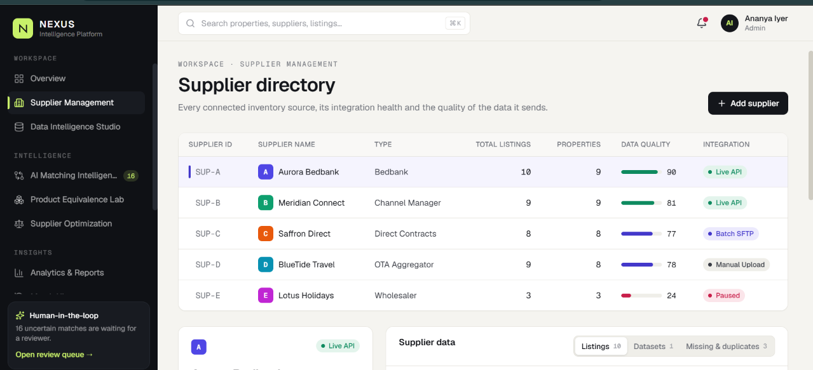

<div align="center">

# NEXUS

### Multi-Supplier Intelligence & Optimization Platform

**Turn fragmented travel-supplier catalogs into unified, comparable, and optimized inventory.**


</div>

---

## 🎯 The Problem

Travel platforms receive hotel and room inventory from many suppliers. The same property appears under different names, addresses, and formats, and the offers attached to it are described inconsistently.

| Pain point | Consequence |
|---|---|
| Duplicate listings across suppliers | Inflated inventory, cluttered search results |
| Inconsistent or incomplete data | Unreliable matching and reporting |
| Room products described differently | Hard to tell what is truly the same product |
| Inclusions and policies differ | **Misleading price comparisons** (refundable + breakfast vs. non-refundable room-only) |
| Manual verification | Slow, expensive, error-prone |
| Competing business priorities | No principled way to pick the best supplier |

## 💡 Our Solution

NEXUS answers two questions that name-matching alone cannot:

1. **Are these listings the same real-world property?**
2. **Are the products on offer genuinely equivalent?**

Only then does it rank suppliers, so the result is the best offer among *comparable* products, not just the cheapest one.

```
Ingest → Normalize → Match → Compare → Optimize → Explain → Human Review
```

---

## 📸 Screenshots


**Overview dashboard**


**Supplier management**


**Matching analytics**


---

## ✨ Key Features

| Module | What it does |
|---|---|
| **Overview** | Pipeline status (ingested → normalized → matched → compared → optimized), KPIs, and a shortcut into the review queue |
| **Supplier Management** | Supplier directory with type, listing/property counts, data-quality score, and integration health (Live API, Batch SFTP, Manual Upload, Paused) |
| **Data Intelligence Studio** | Upload CSV, Excel (.xlsx) or JSON; auto-map columns to a standard schema; apply cleaning rules; preview and export cleaned CSV. Files are parsed in the browser |
| **AI Matching Intelligence** | Scored candidate property pairs with per-signal evidence; confirm, reject, or flag for review; create manual links |
| **Product Equivalence Lab** | Side-by-side room/offer comparison with a classification and a plain-language verdict |
| **Supplier Optimization** | Weighted ranking with hard constraints and a per-parameter score breakdown |
| **Analytics & Reports** | Match precision/recall, confidence distribution, duplicates, supplier completeness and quality, exportable data |
| **Match History** | Audit trail of manual decisions and actions |
| **Notifications, Settings, Profile** | Review alerts, tunable thresholds and tax rate, per-user activity |

---

## 🧠 How It Works

All matching, equivalence, and optimization logic is implemented in TypeScript under [`src/lib`](src/lib) and runs entirely in the browser. It is deliberately lightweight and explainable: every score can be traced back to its evidence.

### 1. Normalization (`normalize.ts`)

- Auto-maps supplier column headers (e.g. `hotel_name`, `property`, `board_basis`) to standard fields using synonym lists plus Jaro-Winkler similarity
- Parses CSV (quoted-field aware), Excel and JSON
- Cleans names, addresses and amenities, and flags missing, invalid, and duplicate rows

### 2. Property matching (`matching.ts`, `similarity.ts`)

Listings are grouped by normalized city (candidate generation), then every pair in a city is scored from five signals:

| Signal | Weight | Technique |
|---|---|---|
| Name | 35% | Token-based fuzzy Dice + sorted Jaro-Winkler + containment; shared location words are stripped so only the brand core is compared |
| Geography | 25% | Haversine distance, scored 1.0 within 100 m, falling to 0 at 1.5 km |
| Address | 20% | Abbreviation-expanded tokens (`rd`→`road`, `bengaluru`→`bangalore`) with fuzzy Dice + containment |
| Attributes | 12% | Amenity Jaccard (canonicalized) + star-rating agreement |
| Description | 8% | Keyword Jaccard |

Design details:

- **Missing evidence is not penalized.** If a signal is unavailable (e.g. no coordinates), its weight is redistributed across the remaining signals.
- **Geographic veto.** Pairs more than 2.5 km apart are capped at a 45% score.
- **Decision handling** (thresholds are configurable in Settings):

| Score | Cross-supplier pair | Same-supplier pair |
|---|---|---|
| ≥ 85% (auto) | ✅ Matched | Duplicate |
| 60–85% | 🟡 Human review queue | Duplicate |
| < 60% | Unmatched | Unmatched |

- Accepted matches are merged into unified properties with **union-find clustering**.

### 3. Room & product equivalence (`equivalence.ts`)

Offers within a matched property are compared across room type, bed, capacity, size (±10%), view, amenities, meal plan, refundability, cancellation deadline/charges, taxes, and extra fees. Critical attributes are weighted double.

| Class | Meaning |
|---|---|
| 🟢 **Exact Equivalent** | Essential attributes and conditions align |
| 🟡 **Similar Product** | Broadly the same, with limited differences |
| 🟠 **Partially Equivalent** | Important differences must be weighed |
| 🔴 **Non-Equivalent** | Not suitable for direct comparison |
| ⚪ **Requires Verification** | Critical data is missing or conflicting |

Each comparison produces a generated verdict explaining *why*.

### 4. Supplier optimization (`optimize.ts`)

Offers are scored on six parameters, combined with user-set weights:

`Price` · `Product equivalence` · `Supplier reliability` · `Cancellation flexibility` · `Data confidence` · `Availability`

- **Effective price** includes taxes (when not already included) and parsed extra charges
- **Hard constraints:** must be refundable, must include breakfast, max budget, minimum equivalence
- Offers that violate a constraint are ranked below all compliant ones, with the violation shown
- Output includes the ranked list, per-parameter contributions, and an explanation

### 5. Human-in-the-loop

Uncertain matches go to a review queue. Confirm, reject, or flag decisions are logged to the audit history and feed back into the matching and analytics views.

> State (decisions, manual links, settings) is persisted in the browser's `localStorage`. Settings has a reset option.

---

## 🧰 Tech Stack

| Layer | Technology |
|---|---|
| Framework | React 19, TypeScript 5.7 |
| Build tool | Vite 8 |
| Styling | Tailwind CSS 4 |
| Icons | lucide-react |
| Excel parsing | read-excel-file |
| Matching / scoring | Custom TypeScript (Jaro-Winkler, fuzzy Dice, Jaccard, Haversine, union-find) |
| Persistence | Browser `localStorage` |
| Package manager | pnpm (Node 22) |

## 📁 Project Structure

```text
Nexus-Intelligence-Platform/
├── public/                 # favicon + README screenshots
├── src/
│   ├── components/         # Shell, charts, shared UI
│   ├── data/               # seed suppliers/listings/datasets, product offers
│   ├── lib/
│   │   ├── normalize.ts    # column mapping, parsing, cleaning
│   │   ├── similarity.ts   # string, address, geo, amenity primitives
│   │   ├── matching.ts     # pair scoring, decisions, clustering
│   │   ├── equivalence.ts  # offer comparison & classification
│   │   └── optimize.ts     # weighted ranking with constraints
│   ├── pages/              # Overview, Suppliers, Studio, Matching,
│   │                       # Equivalence, Optimization, Analytics, History, ...
│   ├── store.tsx           # global state + persistence
│   ├── types.ts
│   └── App.tsx
├── index.html
├── package.json
└── vite.config.ts
```

---

## 🚀 Quick Start

**Prerequisites:** Node.js 22+ and [pnpm](https://pnpm.io/installation) (npm also works).

```bash
git clone https://github.com/krupam26/Nexus-Intelligence-Platform.git
cd Nexus-Intelligence-Platform
pnpm install
pnpm dev
```

Open the URL printed in the terminal. The dev server defaults to port **8443** (override with the `PORT` environment variable).

```bash
pnpm build      # production build
pnpm preview    # preview the production build
```

**Try it:** open *Data Intelligence Studio* and load one of the built-in sample files, or upload your own CSV / Excel / JSON catalog.

---

## 📊 Evaluation

Matching quality is measured against a labelled ground-truth set bundled with the sample data (`GROUND_TRUTH` in `src/data/seed.ts`).

| Area | Metric | Current result (sample set) |
|---|---|---|
| Property matching | Precision | **100%** (15 TP, 0 FP) |
| Property matching | Recall | **48.4%** (16 true pairs not yet linked) |

> Results come from the 39-listing sample dataset (5 suppliers), so treat them as early indicators rather than general performance claims. Precision is high; recall leaves room to improve through threshold tuning and review-queue verification.

Planned metrics: product-equivalence precision/recall, candidate recall, and processing throughput on larger datasets.

---

## 🔭 Roadmap

- [ ] Backend API (e.g. FastAPI) and database for persistent, multi-user storage
- [ ] Embedding-based semantic matching to complement the current lexical signals
- [ ] Learned match classifier trained on verified review decisions
- [ ] Scalable candidate generation (blocking / vector search) for large catalogs
- [ ] Live supplier connectors (API / SFTP)
- [ ] Map-based property verification
- [ ] Price and attribute anomaly detection
- [ ] Role-based access and server-side audit logs

## ⚖️ Design Principles

- **Explain, don't just score.** Every match and recommendation shows its evidence.
- **Surface uncertainty.** Missing or conflicting data is flagged, never silently assumed.
- **Humans stay in control.** Ambiguous cases go to review and decisions are logged.
- **Compare like with like.** Price is only compared across equivalent products.

---

## 👥 Team

**Team Expresso Shot**

- Krupa Mehta
- Siya Rozani
- Kavya Chauhan

## 📄 Note

NEXUS is a decision-support prototype. Recommendations depend on the quality, completeness, and freshness of the supplier data provided. Sample data is illustrative.

---

<div align="center">

**NEXUS: from fragmented supplier data to intelligent decisions.**

</div>
